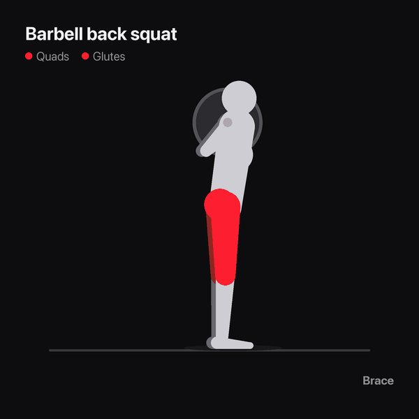
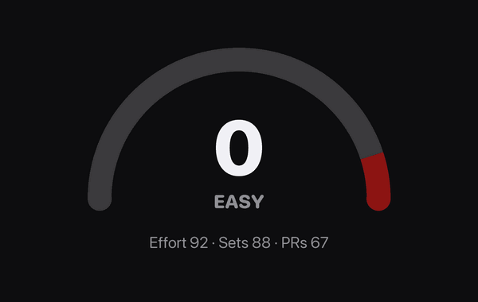
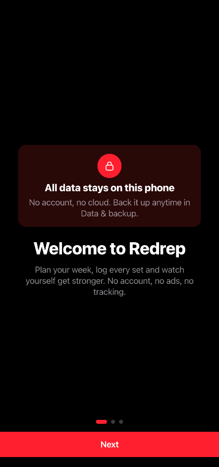
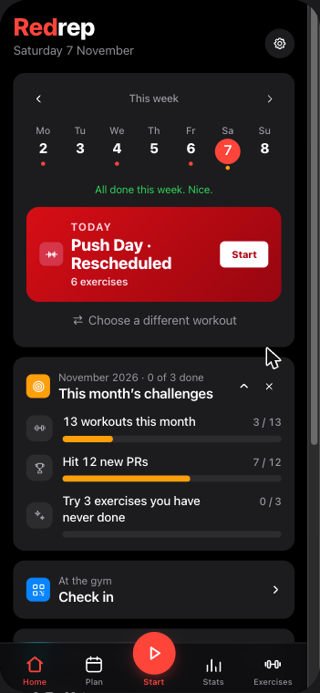
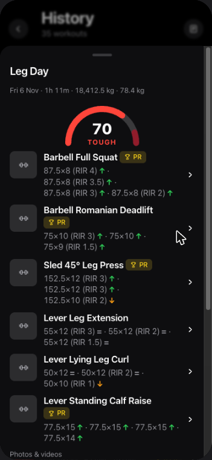
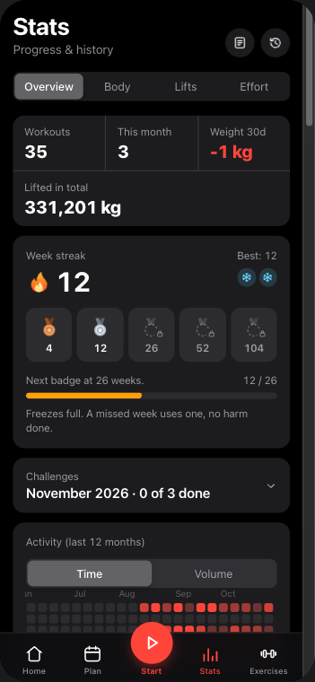
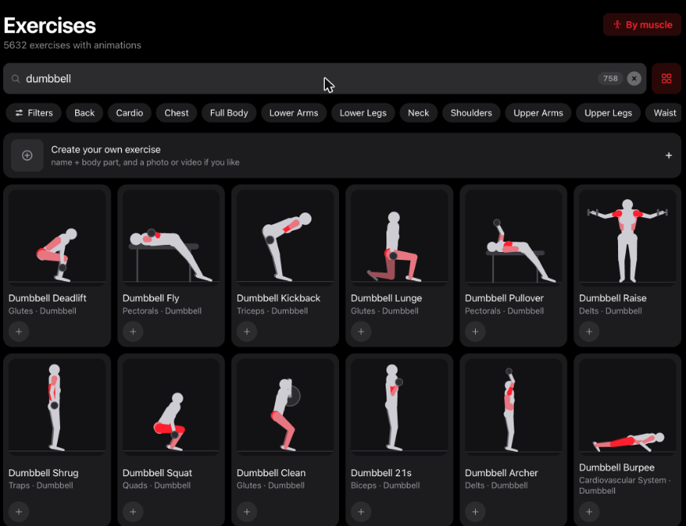

<div align="center">

<h1>Redrep</h1>

**A free workout tracker for iPhone. Plan your week, log every set, see how hard you pushed.**

No account. No sign-in. No ads. No tracking. Nothing to buy.

<p>
  
  
</p>

</div>

Redrep is a gym log for people who lift. Build a weekly plan or load a starter one, follow it set
by set with your last weights filled in, and let the progression rules tell you what to lift next
time. Every finished workout gets a **Redline** score from 0 to 100, so you can see at a glance
whether today was easy, solid, tough or right at the limit. Everything stays on your phone.

<p align="center">
  
  
  
  
</p>

<p align="center">
  
</p>

## What it does

- **Today, front and centre.** Home leads with today's session as a big red card. One tap starts it.
- **Redline.** A 0 to 100 score for every workout, from how close your sets went to failure (RIR or
  RPE), your sets against your usual, and the records you set. Shown as a gauge on the finish
  screen and on every past workout.
- **Every exercise drawn in code.** All 5,632 exercises have an original animated figure, worked
  out from body proportions and joint angles, never traced from video. The muscles each one works
  light up in red, and a cue under the figure says what to do (Lower, Drive up, Hold).
  No image or video files to download.
- **Plans and progression.** A routine per weekday or a rotation, supersets, warm-ups, drop sets,
  timed holds, rest timer, plate math. Linear, double and triple progression, deloads.
- **A library of over 5,600 exercises,** searchable and browsable by muscle on a body map.
- **Progress.** Estimated 1RM curves, a year-long activity map, records, streaks.
- **iPhone extras.** Apple Watch app, widgets, a Live Activity for the rest timer, Apple Health.
- **Starts simple.** A three-step welcome, then just training. Switch on body tracking, streaks and
  more in Settings → Modules whenever you like.
- **20 languages.**

## Free, and staying that way

Redrep has no account and no server of its own. Your plan, workouts and body weight live on your
phone; Settings → Data & backup exports all of it as one file. There are no ads, no analytics and
no in-app purchases.

One optional extra, off by default, is not free to run: the AI coach works only with an API key
from an AI provider you choose, and that provider may charge you for it.

## Status

Redrep is not in the App Store yet. Until it is, you can build it yourself (below).

Still to do before the first release: an app icon of Redrep's own and the store listing.

## Build it yourself

You need a Mac with Xcode 26, Node 22 and CocoaPods.

```bash
git clone https://github.com/Ri4dH/Redrep
cd Redrep/frontend
npm ci
npm run build:mobile          # the web app, copied into the iOS project, plus pod install

open ios/App/App.xcworkspace  # pick your team under Signing & Capabilities, then Run
```

Tests: `npm test` in `frontend/` for the app, `swift test` in `frontend/ios/App/WatchCore` for the
watch logic.

The figures live in `frontend/src/lib/figure/`: `classify.js` picks a movement for each exercise
from its name, the `motions-*.js` files pose the body through it, and `draw.js` turns a pose into
SVG. The README animations are made by `scripts/redrep/squat_gif.py` and
`scripts/redrep/redline_gif.py` (Python with Pillow).

## Credits and licence

Redrep is a fork of [**openGym**](https://github.com/DuarteSantos8/openGym) by Duarte Santos and
its contributors, and keeps its licence: the [GNU AGPL v3.0](LICENSE). The source of every
version of Redrep is published here.

The repository still holds openGym's optional self-hosted server (`api/`, `web/`, and
[docs/SELF_HOSTING.md](docs/SELF_HOSTING.md)). The Redrep iPhone app does not use it.

> [!IMPORTANT]
> **The exercise stills and animations in `catalogue/media` are not covered by the AGPL.** They
> are © Aliaksandr Makatserchyk, [Gym visual](https://gymvisual.com/), licensed for use in openGym
> only, and kept here unmodified at 180 px with their notice. The Redrep app does not use or ship
> them: it draws every exercise itself. Full notices, including the MIT-licensed body map
> geometry, are in [NOTICE.md](NOTICE.md).
